

# Rosebank International Cafeteria 

## Project Context
A multi-page HTML website for Rosebank International Cafeteria which is a hypothetical cafeteria. Built by Nyeleti Pertunia Mukhawana for WEDE5020 (Web Development) PoE.

## Website Purpose
To make the cafeteria a well-organized, easily accessible dining service that reduces queuing time and confusion, and keeps students informed about what's on offer.

## Target Audience
Rosebank International Students,Lectures and other Academic Staff, Staff Members,Campus visitors

## Main Pages
Home - inde.html
About Us - about.html
Menu - menu.html
Gallery - gallery.html
Feedback - feedback.html
Contact Us - contact.html

## Technology used
HTML5, CSS, Git/GitHub, VS Code

## How to Run
Clone or download this repository.
Open the folder in VS Code.
Open index.html in a browser, or use the VS Code "Live Server" extension.

## Repository Structure
ri-pta-wede5020-part1-part2-part3-ST10512276
├── docs/
│   └── sitemap.png
├── index.html
├── about.html
├── menu.html
├── gallery.html
├── feedback.html
├── contact.html
├── images/
├── css/
│   └── style.css
├── README.md
└── CHANGELOG.md

Responsive Testing
The site was tested at three breakpoints using browser DevTools
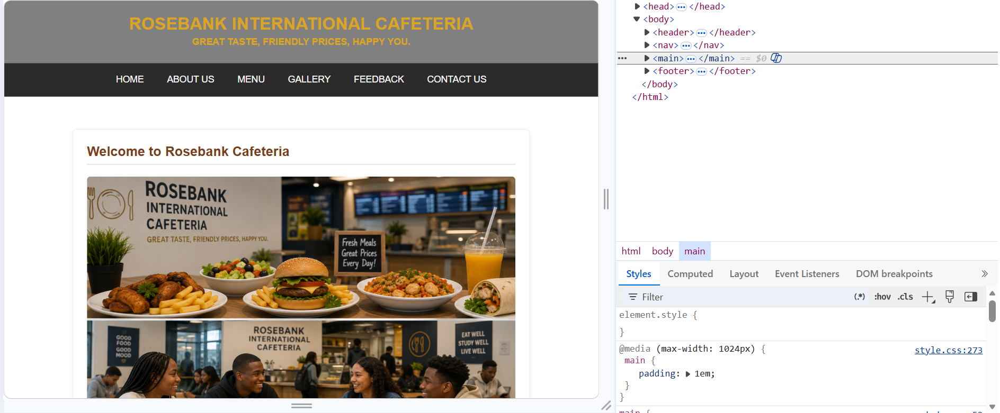
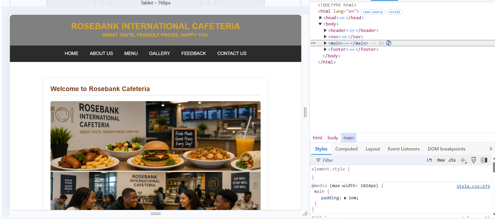
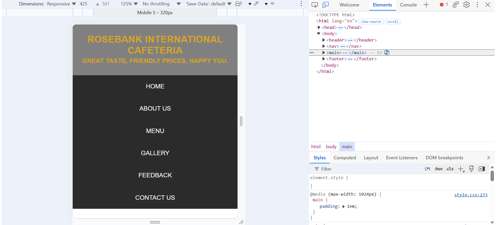

## SEO Keyword Reasearch
To find keywords, I typed phrases like "Rosebank Cafeteria" into Google and looked at the suggested searches and the "People also ask" box. I chose keywords that match the name of the cafeteria and what it really offers, and I used each one naturally in the page text.

| Page      | Main keywords |
|---|---|
| Home| Rosebank Cafeteria, Rosebank International Cafeteria |
| About Us| Rosebank Cafeteria, affordable student meals |
| Menu| Rosebank Cafeteria menu, breakfast, lunch, snacks and drinks |
| Gallery| Rosebank Cafeteria photos, cafeteria meals |
| Feedback| Rosebank Cafeteria feedback |
| Contact| Rosebank International Pretoria Campus, Rosebank College Cafeteria, Rosebank Cafeteria opening hours |
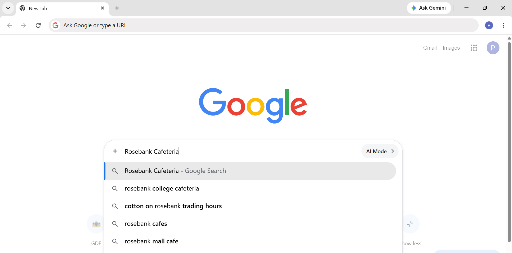
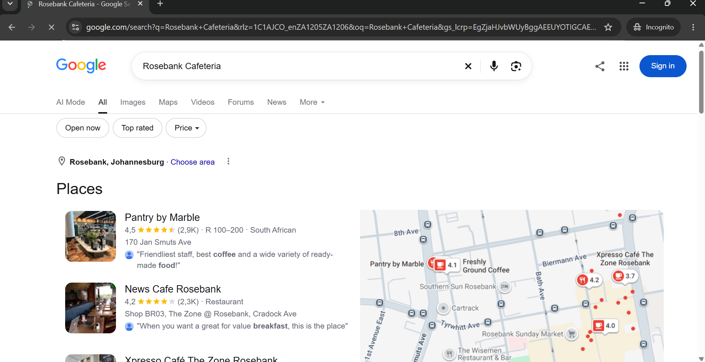
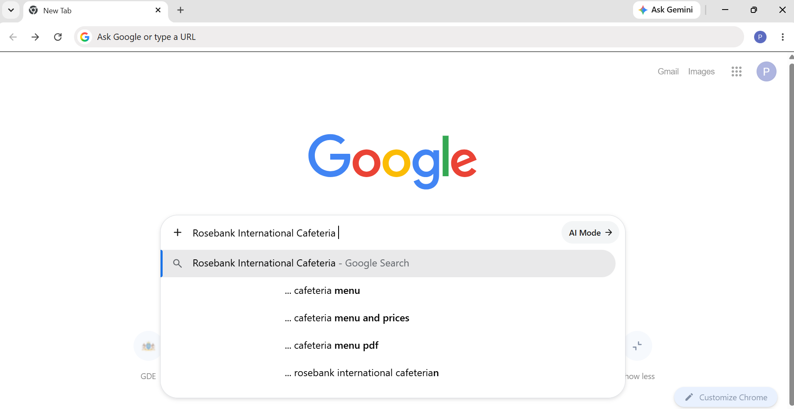
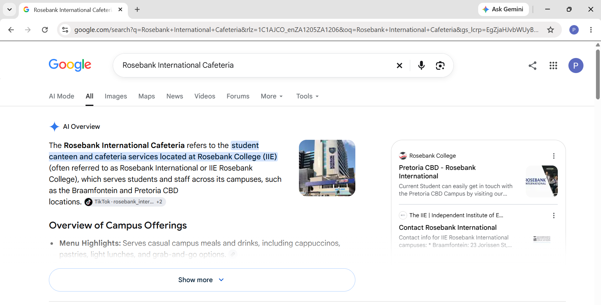

## SEO Header Tags
Each page has one H1 (the cafeteria name in the header). The main sections of each page use H2, and the meal names in the Popular Meals section on the Home page use H3. No heading levels are skipped.

## SEO Image Optimisation
Images have descriptive file names written in lowercase with dashes, for example 'rosebank-international-cafeteria-logo.png' and 'fruit-juice.jpg'. File names with spaces or unclear names were renamed. Each image also has alt text that describes what the picture shows, which also helps people using screen readers.

## SEO URL Structure
The website uses short, clean and descriptive page names in lowercase, for example `menu.html`, `gallery.html` and `contact.html`. They match the names in the navigation menu and contain no spaces or special characters. The folders are also named clearly (`css`, `js` and `image`), and file names do not contain spaces.
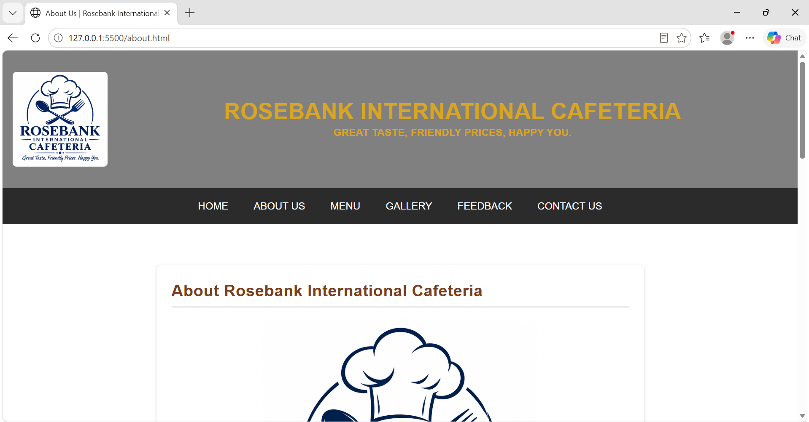 

## SEO Internal Linking
All pages are linked together through the navigation menu, and the logo links back to the Home page. I also added links inside the page text with clear wording, for example from the Home page to the Menu page, and from the Contact page to the Menu and Feedback pages. The "View Menu" and "Give Feedback" buttons also link to other pages.

## SEO Mobile-Friendliness

All pages include the viewport meta tag and use CSS media queries at 1024px and 600px. On phones, the navigation bar changes into a menu button, the grids change to one column, and images, the map and the form fields shrink to fit the screen. I tested the website at phone and tablet sizes and checked it with Lighthouse.
Lighthouse mobile results for the Home page: Performance 73, Accessibility 94, Best Practices 100 and SEO 100.
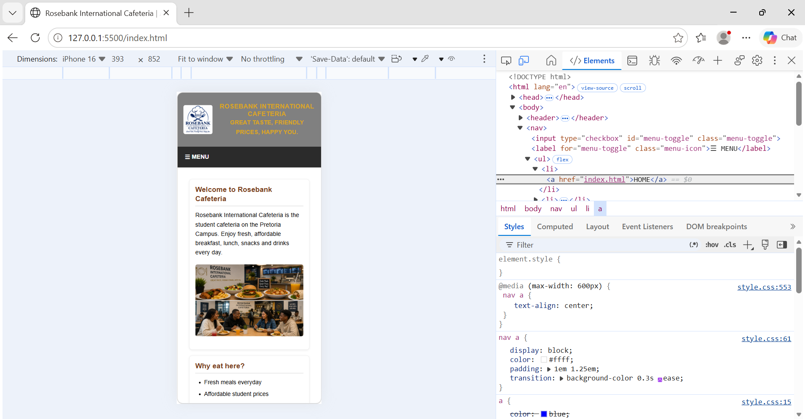

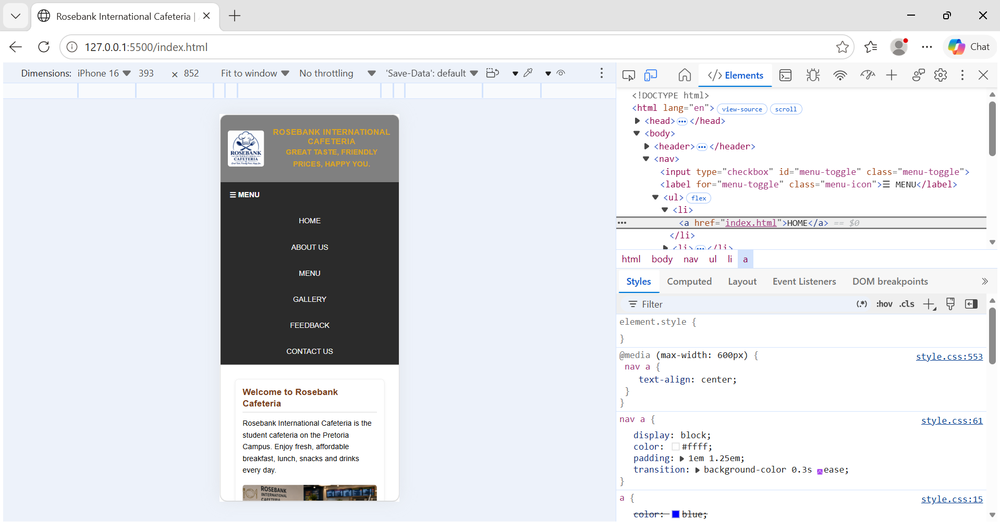

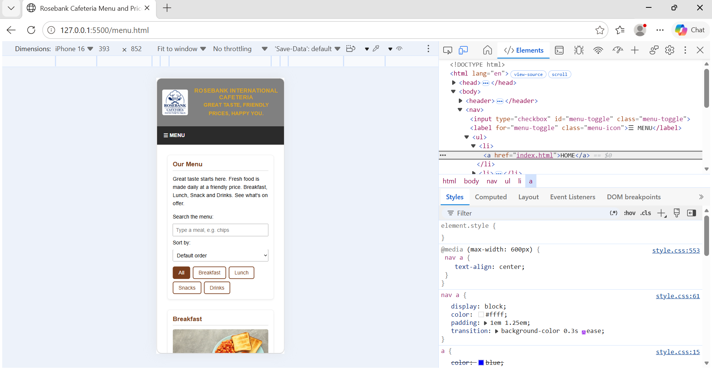

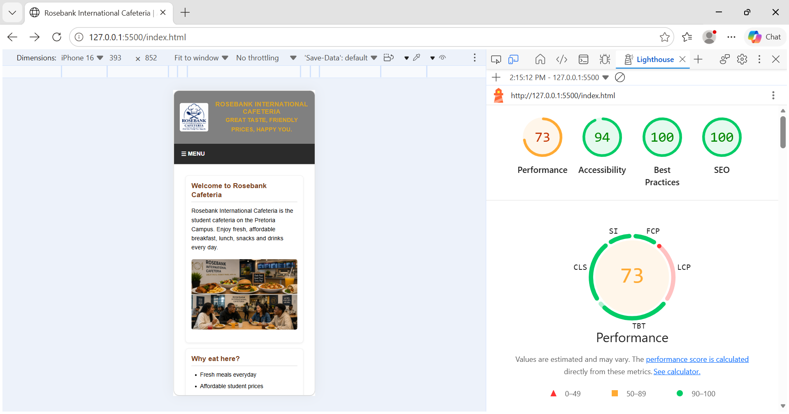

## SEO Off-Page

### Backlinks
Backlinks are links from other websites to my website. Because this is a student project, I could not
build real backlinks. All my internal links use clear words such as "Contact page" so search engines understand where they go.

### Social Media
I added Facebook and Instagram links in the footer of every page, and a WhatsApp share link that shares
the page the visitor is on. I also added Open Graph tags so a shared link shows a title, description
and picture.

### Local SEO
I added structured data (schema.org) on the Contact page with the cafeteria name, phone number, email,
location and opening hours. My titles and descriptions mention the Pretoria Campus. The name, phone
number and opening hours are the same on every page.

## SEO Additional Requests

### Robots.txt
Created a robots.txt file in the main folder. It lets all search engine crawlers visit the website
and hides the docs folder, because it only holds my README screenshots. It also shows the address of
my sitemap.

### Sitemap.xml
Created a sitemap.xml file in the main folder that lists all 6 pages. It helps search engines
understand the structure of the website and find every page.

### Page Speed
Added loading="lazy" to the images on the Menu and Gallery pages and to the Popular Meals images
made by JavaScript, so they only load when the visitor scrolls down to them. It is not added to the
logo or the Home banner, because they are at the top and must load first. All images have a width and height so the page does not jump
while loading, and the JavaScript files are loaded at the bottom of the page.
### Security
Added a Content Security Policy in the head of every page so the browser only allows content from
my own files, jQuery and Google Maps. Also added a referrer policy. The links that open in a new
tab use rel="noopener". Added maxlength to the name and comment fields and
kept the required and email validation on the Feedback form. The website does not collect passwords.

# Form Functionality and Validation

## Contact Form
The Contact page includes a form that allows a visitor to send a message to the cafeteria. The form collects the visitor's name, email address, phone number, type of message (selected from a drop-down list) and a full message typed in a text area. The recipient address (Cafeteria@rbipta.ac.za) is stated in the JavaScript code and in the form's action attribute.

JavaScript validates every field before the form is submitted:
- Name: letters only, at least 2 characters.
- Email: must follow the format name@example.com.
- Phone number: 10 digits starting with 0.
- Type of message: an option must be chosen.
- Message: between 10 and 500 characters, with a live character counter.

If a field is invalid, an error message is displayed under the field and the field is highlighted in
red. Once all fields are valid, the information is compiled into an email and the visitor's email application opens with the message ready to send.

## Enquiry Form
The Enquiry page provides a catering enquiry form for events such as society meetings, staff functions
and study group lunches. The form collects the visitor's name, email address, phone number, event date,
number of people (drop-down list for the meal package) and optional notes. The form element contains an
action attribute, and JavaScript handles the submission so that the page does not reload.

JavaScript validates every field before the form is processed:
- Name: letters only, at least 2 characters.
- Email: must follow the format name@example.com.
- Phone number: 10 digits starting with 0.
- Event date: must be tomorrow or later and within the next 6 months.
- Number of people: a number between 10 and 200.
- Meal package: an option must be chosen.
- Notes: optional, with a maximum of 200 characters.

Error messages are displayed under each invalid field. Once the input is valid, the form data is sent
with AJAX (jQuery) to a JSON file (data/packages.json) that stores the package prices. The page then
displays a response without reloading, which shows the price per person, the subtotal, a 10% discount
for groups of 50 or more, the estimated total and the availability of the chosen date. The response
reports that the cafeteria is closed on Sundays, that Saturday collections must be before 1pm, and that
groups of more than 100 people require at least 5 days' notice.

## E-Commerce Features

### Add to Cart
The Menu page allows customers to add meals to a shopping cart. An ADD TO CART button is created by
JavaScript for every meal, using the meal name and price shown on the page. This means that any meal
added to the menu in the future receives a button automatically. When a meal is added more than once, the quantity increases instead of creating a duplicate entry. The cart is stored in the browser with
localStorage, so the order is kept when the customer moves between pages. The total number of items is displayed next to the CART link in the navigation bar on every page.

### Checkout and Order Placement
The checkout form is part of the Cart page, so the customer can review the cart and place the order on
one page. The form collects the customer's name, phone number, collection time, payment method (cash or
card at the counter) and optional notes. JavaScript validates every field before the order is accepted:
- Name: letters only, at least 2 characters.
- Phone number: 10 digits starting with 0.
- Collection time: must fall within the opening hours (08:00 to 17:00 on weekdays and 08:00 to 13:00 on
  Saturdays). Orders are rejected on Sundays, because the cafeteria is closed.
- Payment method: an option must be chosen.
- Notes: optional, with a maximum of 100 characters.

Error messages are displayed under invalid fields. When the input is valid, an order confirmation is
displayed with a generated order number, the collection time, the payment method, the ordered meals
and the total. The cart is then emptied and the item counter is reset. Customer notes are displayed
as plain text to prevent injected HTML from being executed. Because the website has no back-end
server, the order is confirmed on the screen only and is not transmitted to the cafeteria. In a
production system, the order would be sent to a server or an email service.

## References
DataFlair, n.d. CSS Responsive Web Design Tutorial. [online] Available at: <https://data-flair.training/blogs/css-responsive-design/> [Accessed 18 September 2026].

Google, 2026. Google Maps. [online] Available at: <https://www.google.com/maps> [Accessed 15 September 2026].

Refine, n.d. Rem vs Em in CSS: What's the Difference? [online] Available at: <https://refine.dev/blog/rem-vs-em/> [Accessed 17 September 2026].

Usersnap Blog, 2026. Best feedback template 2026. [online] Available at: <https://usersnap.com/blog/feedback-form/amp/> [Accessed 12 August 2026].

W3Schools, n.d. CSS Tutorial. [online] Available at: <https://www.w3schools.com/css/> [Accessed 16 September 2026].

W3Schools, n.d. HTML-CSS. [video online] Available at: <https://www.w3schools.com/html/> [Accessed 13 August 2026].

Chrome for Developers, n.d. *Introduction to Lighthouse*. [online] Available at: <https://developer.chrome.com/docs/lighthouse/overview> [Accessed 29 October 2026].

Google, n.d. *How Google autocomplete predictions work*. [online] Available at: <https://support.google.com/websearch/answer/7368877> [Accessed 29 October 2026].

Google, 2026. *Introduction to robots.txt*. [online] Available at: <https://developers.google.com/search/docs/crawling-indexing/robots/intro> [Accessed 31 October 2026].

Google Search Central, n.d. *Control your snippets in search results*. [online] Available at: <https://developers.google.com/search/docs/appearance/snippet> [Accessed 29 October 2026].

Google Search Central, n.d. *Google image SEO best practices*. [online] Available at: <https://support.google.com/webmasters/answer/114016> [Accessed 29 October 2026].

Google Search Central, n.d. *Influencing your title links in search results*. [online] Available at: <https://developers.google.com/search/docs/appearance/title-link> [Accessed 29 October 2026].

Google Search Central, n.d. *Link best practices for Google*. [online] Available at: <https://developers.google.com/search/docs/crawling-indexing/links-crawlable> [Accessed 29 October 2026].

jQuery, n.d. *slideToggle()*. [online] Available at: <https://api.jquery.com/slidetoggle/> [Accessed 28 October 2026].

jQuery, 2026. *jQuery.ajax()*. [online] Available at: <https://api.jquery.com/jQuery.ajax/> [Accessed 2 November 2026].

MDN Web Docs, n.d. *CSS media queries*. [online] Available at: <https://developer.mozilla.org/en-US/docs/Web/CSS/CSS_media_queries> [Accessed 29 October 2026].

MDN Web Docs, n.d. *Viewport meta tag*. [online] Available at: <https://developer.mozilla.org/en-US/docs/Web/HTML/Viewport_meta_tag> [Accessed 29 October 2026].

MDN Web Docs, 2026. *Client-side form validation*. [online] Available at: <https://developer.mozilla.org/en-US/docs/Learn_web_development/Extensions/Forms/Form_validation> [Accessed 2 November 2026].

MDN Web Docs, 2026. *Content Security Policy (CSP)*. [online] Available at: <https://developer.mozilla.org/en-US/docs/Web/HTTP/CSP> [Accessed 31 October 2026].

MDN Web Docs, 2026. *Regular expressions*. [online] Available at: <https://developer.mozilla.org/en-US/docs/Web/JavaScript/Guide/Regular_expressions> [Accessed 2 November 2026].

MDN Web Docs, 2026. *Window: localStorage property*. [online] Available at: <https://developer.mozilla.org/en-US/docs/Web/API/Window/localStorage> [Accessed 2 November 2026].

Open Graph protocol, 2026. *The Open Graph protocol*. [online] Available at: <https://ogp.me/> [Accessed 30 October 2026].

Schema.org, 2026. *CafeOrCoffeeShop*. [online] Available at: <https://schema.org/CafeOrCoffeeShop> [Accessed 30 October 2026].

Sitemaps.org, 2026. *Sitemaps XML format*. [online] Available at: <https://www.sitemaps.org/protocol.html> [Accessed 31 October 2026].

W3Schools, n.d. *How to create a modal image*. [online] Available at: <https://www.w3schools.com/howto/howto_css_modal_images.asp> [Accessed 28 October 2026].

W3Schools, n.d. *CSS animations*. [online] Available at: <https://www.w3schools.com/css/css3_animations.asp> [Accessed 28 October 2026].

W3Schools, n.d. *JavaScript array sort*. [online] Available at: <https://www.w3schools.com/js/js_array_sort.asp> [Accessed 28 October 2026].

web.dev, 2026. *Browser-level image lazy-loading for the web*. [online] Available at: <https://web.dev/articles/browser-level-image-lazy-loading> [Accessed 31 October 2026].